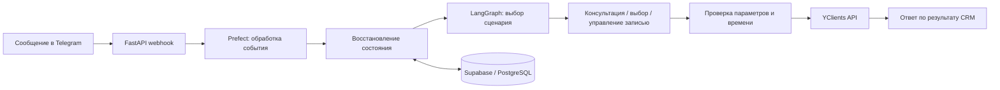

# Устройство agent_p

Это объяснение основной системы; автономный `scenario_demo.py` реализует только маленькую иллюстрацию проверки записи.

## Ответственность компонентов

- **FastAPI + aiogram:** входящие сообщения и действия Telegram.
- **Prefect:** выполнение оркестрации.
- **LangGraph:** маршрут между Supervisor, Canvas, Info, Executor, Manager, Rescheduler и Responder.
- **Canvas:** объединение параметров, проверка согласованности и интерфейс выбора.
- **Info:** ответы о каталоге, ценах и доступности; консультация не означает созданной записи.
- **Executor:** финальная проверка и создание записи.
- **Manager / Rescheduler:** просмотр, отмена и изменение записи.
- **Supabase/PostgreSQL:** состояние и история работы; Vue/TypeScript — интерфейсный слой.

## Граница LLM и CRM

Модель помогает понять запрос и выбрать следующий шаг. Доступность времени и факт записи определяются через API. Сообщение об успешной записи нельзя выводить только из текста диалога. Конфликт параметров требует восстановления, а неизвестная доступность блокирует создание.

Реализация основного проекта содержит повторную проверку слота и идентификацию команды. Поддержка нескольких услуг есть в модели и интерфейсе; успешный полный путь с реальной CRM здесь не установлен. Передача оператору в текущем графе обозначена заглушкой.

## Что показывает маленький пример

`Command` хранит вымышленные ссылки на клиента, услуги, мастера и время. `BookingExample` проверяет подтверждение и согласованность, затем доступность. `FakeCRM` отвечает success/rejected/uncertain; результат повтора хранится в памяти. Тесты проверяют наблюдаемые действия и количество вызовов адаптера.

Это схема для объяснения решения. У неё нет LLM, веб-сервера, настоящих клиентов и провайдеров. Перенос такого примера в production требует отдельного проектирования хранения, конкурентности, восстановления и внешних контрактов.
